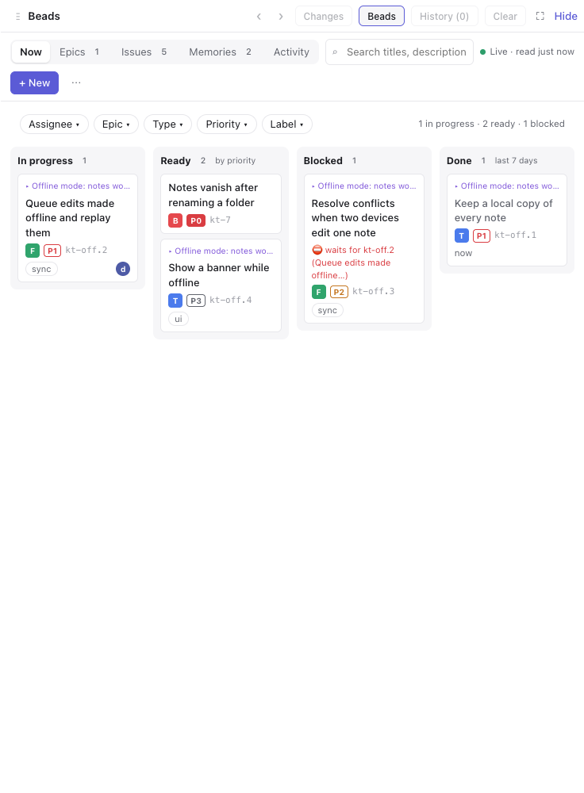
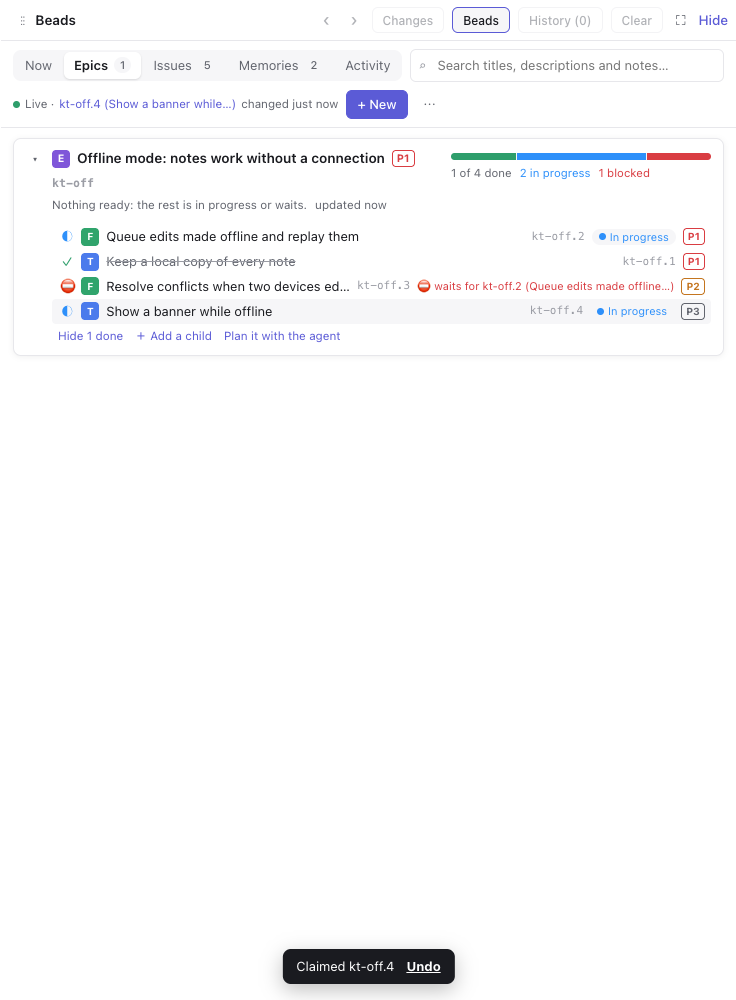
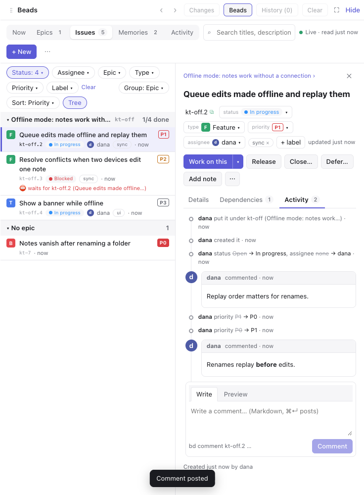
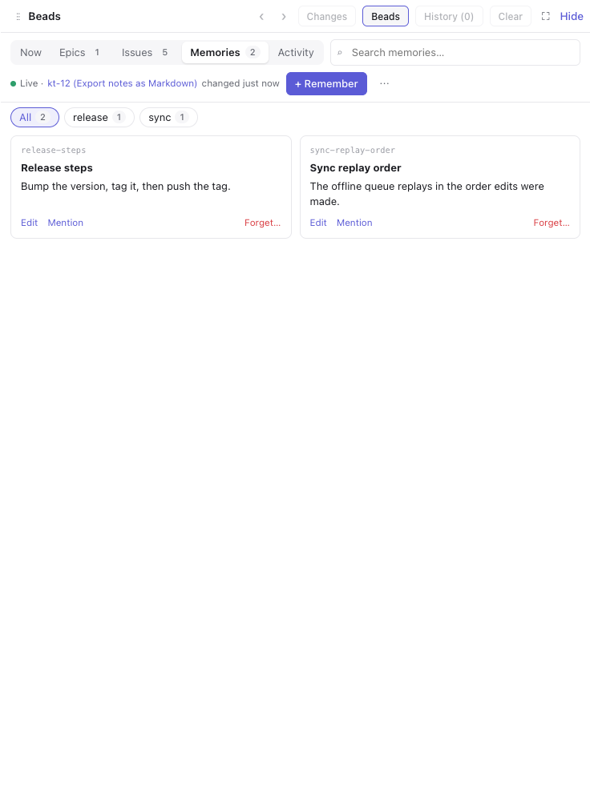
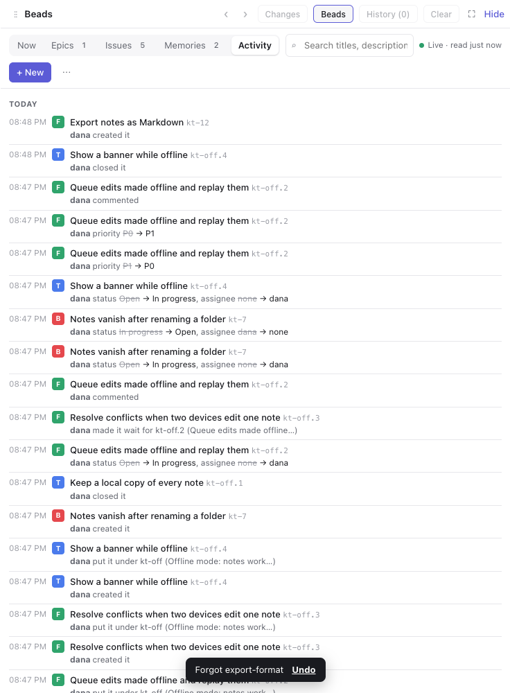

# Beads for Mirador

A [Mirador](https://github.com/sodre90/mirador) plugin: the [beads](https://github.com/gastownhall/beads) of a workspace (its epics, issues and memories) in a tab beside the chat, where you see what's going on, change it in a click and hand work to the agent.



- **Connects by itself.** The tab finds the database `bd` sees in the workspace's folder and connects once you confirm.
- **Now.** A board of what's in progress, what's ready (open, with nothing open in its way), what's blocked and what closed this week. Drag a ready card to In progress to claim it, or to Done to close it.
- **Epics.** Each open epic with its progress bar, what's next, and the tree of its work. An epic whose work is all done offers to close itself. Hand an epic to the agent to plan.
- **Issues.** One list with chips for status, assignee, epic, type, priority and label. It groups by epic, status, type or priority and shows children under their parents. The search reads descriptions, design, acceptance criteria and notes too.
- **Detail beside the list.** Status, type, priority, assignee and labels change from their pickers. Description, design, acceptance criteria and notes edit from it, in Markdown with a preview. A map shows what the issue waits for and what waits for it, and the timeline shows its comments and every change from bd's events journal.
- **Memories.** What `bd remember` keeps, grouped by key, searched as you type, edited, mentioned to the agent or forgotten.
- **Activity.** What happened across the database, by whom, day by day.
- **Small edits at once, with Undo.** A claim, a status, a priority or a label takes effect as you click, with Undo in the toast. Undo won't overwrite a change someone made since. Closing, deferring, creating and forgetting ask first and show the `bd` command they run.
- **Work on this.** Start a conversation on an issue (the agent claims it, works on it and closes it), send it to the current conversation, or mention it in the composer.
- **Live.** The tab reads again whenever the database changes, whether an agent, a terminal or you changed it, and marks what changed.
- **Keys.** `1`–`5` switch views, `j` `k` move, `/` searches, `n` makes a new issue, `w` works on it, `x` closes it, `c` comments, `r` reads again.









Everything goes through the `bd` on your computer, as your agents' writes do. The plugin keeps no copy of the database. It needs Mirador with plugin API 7, and is tested with bd 1.3. For the timeline and the activity feed, turn on bd's events journal with `bd config set events-journal true`.

To install it, add `https://github.com/sodre90/mirador-beads-ui.git` in Settings → Plugins.

## Developing

```bash
bun install
bun run build       # the view, into dist/view.js
bun run typecheck
bun run test        # unit tests, against a fake bd
scripts/e2e.sh      # e2e in a Mirador test host from MIRADOR_DIR, with the real bd on a made-up database
```

`MIRADOR_DIR` is Mirador's checkout, by default `../visualized-claude-sessions`. `mirador/api.ts` is a copy of the plugin API types Mirador doesn't publish yet. `BEADS_SCREENSHOTS=<folder> scripts/e2e.sh` also saves a screenshot of each view, as in `docs/`.

Releases: bump `version` in `plugin.json`, commit, and tag the commit `v<version>`. Mirador installs the newest release and offers newer ones as updates.
